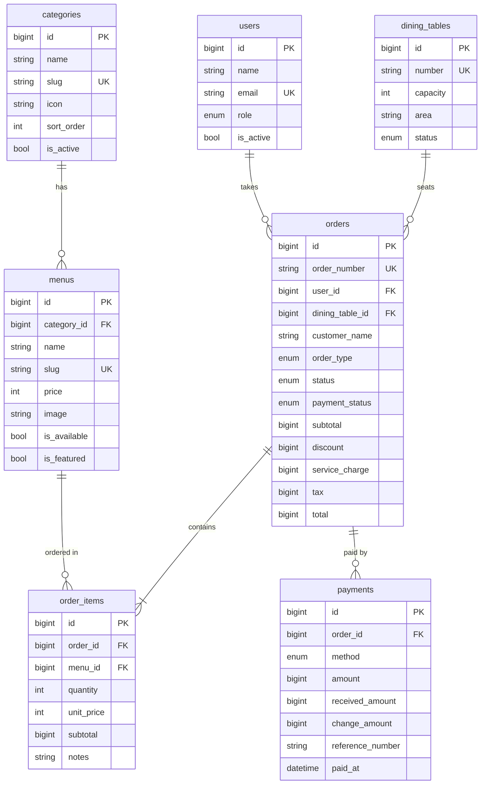

# Database: Sistem Pemesanan Restoran/Kafe

## Quick start

```bash
# 1. Start MySQL in XAMPP and create the database "restoran_db" (utf8mb4_unicode_ci)
# 2. Then:
php artisan migrate:fresh --seed
```

Staff logins (password for all: **`password`**)

| Email | Role |
|---|---|
| admin@kafe.test | admin |
| kasir@kafe.test, kasir2@kafe.test | cashier |
| pelayan@kafe.test, pelayan2@kafe.test | waiter |
| dapur@kafe.test | kitchen |
| joko@kafe.test | waiter (**inactive**) |

## ERD



## Relations (Eloquent)

| Relation | Type | Code |
|---|---|---|
| Category → Menu | One-to-Many | `$category->menus`, `$menu->category` |
| Order ↔ Menu | Many-to-Many (pivot `order_items`) | `$order->menus`, `$menu->orders` |
| Order → OrderItem | One-to-Many | `$order->items`, `$item->menu` |
| Order → Payment | One-to-Many (split bill) | `$order->payments` |
| DiningTable → Order | One-to-Many | `$table->orders`, `$table->activeOrders` |
| User → Order | One-to-Many | `$user->orders`, `$order->user` |

Eager loading examples (required by the assignment):

```php
Category::active()->ordered()->withCount('menus')->get();                      // category list page
Category::with('menus')->findOrFail($id);                                      // category detail page
Menu::with('category')->available()->get();                                    // menu list page
Order::with(['items.menu.category', 'diningTable', 'user', 'payments'])->findOrFail($id); // order detail
```

## Design decisions

| Decision | Why |
|---|---|
| `order_items.unit_price` (price snapshot) | If a menu price changes, old orders and revenue reports must not change. |
| Money stored as whole Rupiah integers | Rupiah has no cents; integers avoid float rounding bugs. |
| Order totals stored, not recomputed | History stays correct even if the tax rate changes. Calculate with `Order::calculateTotals()`. |
| Soft deletes on `categories` and `menus` | Deleted menus still show up on old orders (`withTrashed()`). |
| `menus.category_id` RESTRICT, `order_items.menu_id` RESTRICT | Data that has been ordered can never be hard-deleted by accident. |
| `order_items.order_id` / `payments.order_id` CASCADE | Deleting an order removes its lines and payments. |
| `orders.user_id` / `dining_table_id` SET NULL | Removing a staff account or table keeps the sales history. |
| `dining_tables` (not `tables`) | Avoids confusion with database "tables". |
| Customers are not a table | Cafe walk-in customers don't register, so `customer_name` is stored on the order. |

Totals formula (`config/restaurant.php`):
`service = (subtotal − discount) × 5%` (dine-in only), `tax PB1 = (subtotal − discount + service) × 10%`.

## Dropdown values (use the model constants in Blade)

```blade
<select name="category_id">
  @foreach ($categories as $c) <option value="{{ $c->id }}">{{ $c->name }}</option> @endforeach
</select>

@foreach (App\Models\Order::TYPES as $value => $label) ... @endforeach
@foreach (App\Models\Order::STATUSES as $value => $label) ... @endforeach
@foreach (App\Models\Payment::METHODS as $value => $label) ... @endforeach
```

Accessors you can use in views: `$menu->formatted_price` (`Rp 25.000`), `$order->formatted_total`, `$order->status_label`, `$order->type_label`, `$order->payment_status_label`, `$payment->method_label`, `$user->role_label`.

## Seed data summary

- 7 categories (1 inactive: *Menu Musiman*)
- 36 menus (2 unavailable, 7 best sellers)
- 12 tables (Indoor / Outdoor / VIP; VIP2 reserved)
- ~105 orders over the last 30 days, including ~7 **still active right now** (pending/preparing/served) for the live demo. Their tables are marked `occupied`.
- Payments for every completed order (cash with change, QRIS, e-wallet, cards)
- Fixed random seed, so every teammate gets the same data.
